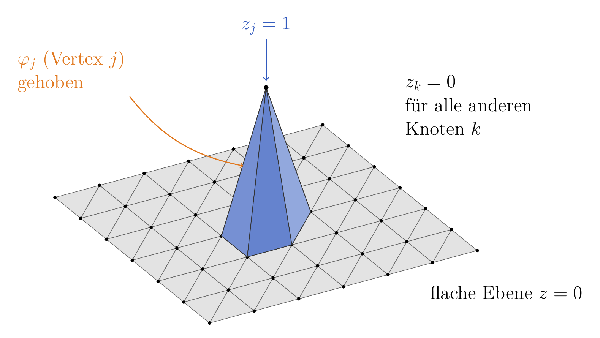
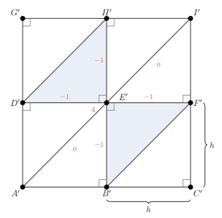
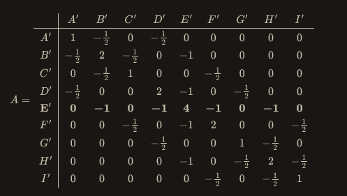

# Dokumentation fem2d

*AI-Disclaimer: this document has been created with the help of Claude Opus 5.5. Claude helped with the wording, with correcting mistakes and with the translation, but the content and structure has otherwise been created, edited and supervised by humans.*

Diese Doku erklärt, wie das Programm `fem2d` die Poisson-Gleichung $-\Delta u = f$ auf einem Dreiecksgitter löst. Zunächst folgen die theoretischen Grundlagen bis $Az = b$, dann eine Rechnung von Hand, und als letztes der Algorithmus, wobei der passende Code aus `src/main.cc` entsprechend dabei steht. Am Ende sind die einzelnen Dateien des Programms und ein paar Beispiele zum Ausprobieren aufgeführt.

Kompass:
- Programm bauen und starten: siehe `README.md`
- Weg von der `.geo` bis zu ParaView: siehe `docs/pipeline.md`

## 0. Was das Programm kann

`fem2d` liest ein Dreiecksgitter von Gmsh ein, stellt daraus mit linearen Hutfunktionen (P1-Elemente) das Gleichungssystem $Az = b$ auf, löst es und schreibt die Lösung als `.vtk` für ParaView raus. Im jetzigen Stand gilt dabei:
- $k = 1$, wir lösen also nur $-\Delta u = f$
- auf dem ganzen Rand ist $u = 0$ vorgegeben (homogene Dirichlet-Bedingung); andere Randwerte oder Neumann-Ränder sind noch nicht eingebaut
- $f$ wird als Lambda oben in `src/main.cc` festgelegt und nicht aus einer Datei gelesen, d.h. für ein anderes $f$ muss man neu bauen
- gelesen werden nur ASCII-Dateien im Gmsh-Format 2.x oder 4.x

## 1. Mathematischer Hintergrund und Problemformulierung

Wir wollen die PDE $-\nabla\cdot(k\nabla u)=f$ bzw. $-\Delta u=f$ für $k = 1$ mit einer gegebenen Quellfunktion $f$ und $u = 0$ auf dem Rand lösen; damit untersuchen wir ein Skalarfeld in einem vorgegebenen Mesh und unter Berücksichtigung von lokalen Besonderheiten. $u$ können wir allgemein nicht direkt ausrechnen, aber annähern.

Dafür verwenden wir Hutfunktionen. Zu jedem Knoten $i$ des Gitters gehört eine Funktion $\varphi_i$ mit

$$\varphi_i\in C^0(\overline\Omega),\qquad \varphi_i\big|_T\in\mathbb{P}_1\ \ \forall\,T\in\mathcal{T}_h,\qquad \varphi_i(x_j)=\delta_{ij}=\begin{cases}1 & i=j\\ 0 & i\neq j\end{cases}$$

Sie ist auf dem ganzen Gebiet $\overline\Omega$ stetig, auf jedem Dreieck $T$ ein lineares Polynom $a + bx + cy$ und damit eine flache, schräge Ebene, und sie liegt am eigenen Knoten $i$ auf Höhe 1 und an allen anderen Knoten des Gitters auf 0.



Aus den Hutfunktionen setzen wir die Näherung

$$u_h=\sum_j z_j\,\varphi_j$$

zusammen, wobei die Knotenwerte $z_j=u_h(x_j)$ das sind, was das Programm am Ende berechnet.

In $-\Delta u=f$ können wir $u_h$ nicht direkt einsetzen, weil die zweiten Ableitungen einer stückweise linearen Funktion 0 bzw. nicht definiert sind. Deshalb verwenden wir die schwache Form, in der nur die ersten Ableitungen vorkommen,

$$\int_\Omega\nabla u_h\cdot\nabla\varphi_i\,dx=\int_\Omega f\varphi_i\,dx$$

Das gibt für jeden Knoten $i$ eine Gleichung und zusammen das lineare Gleichungssystem

$$Az = b,\qquad A_{ij}=\int_\Omega \nabla\varphi_i\cdot\nabla\varphi_j\,dx,\qquad b_i=\int_\Omega f\varphi_i\,dx$$

## 2. Beispielrechnung von Hand

Bevor wir zum allgemeinen Fall kommen, rechnen wir $Az = b$ einmal an einem kleinen Gitter mit 9 Knoten $A'$ bis $I'$ durch, das aus acht rechtwinkligen Dreiecken mit Katheten der Länge $h$ besteht.



Da alle Dreiecke deckungsgleich sind, reicht es, ein Referenzdreieck mit dem rechten Winkel bei $(0, 0)$ und den anderen Ecken bei $(h, 0)$ und $(0, h)$ zu betrachten. Die drei Hutfunktionen darauf sind

$$\varphi_0 = 1 - \tfrac{1}{h}x - \tfrac{1}{h}y,\qquad \varphi_1=\tfrac1h x,\qquad \varphi_2=\tfrac1h y$$

mit den Gradienten $\nabla\varphi_0=\left(-\tfrac1h,\ -\tfrac1h\right)$, $\nabla\varphi_1=\left(\tfrac1h,\ 0\right)$ und $\nabla\varphi_2=\left(0,\ \tfrac1h\right)$.

Weil die Gradienten auf dem Dreieck konstant sind, wird jedes Integral zu Wert mal Fläche $|T|=\tfrac{h^2}{2}$, und für die lokale Matrix folgt

$$A^{\text{lok}}_{ab}=|T|\,\nabla\varphi_a\cdot\nabla\varphi_b,\qquad A^{\text{lok}}=\begin{pmatrix}1&-\tfrac12&-\tfrac12\\-\tfrac12&\tfrac12&0\\-\tfrac12&0&\tfrac12\end{pmatrix}$$

Der rechte Winkel bekommt auf der Diagonale 1, die spitzen Ecken ½, die Einträge entlang der Katheten −½ und der Eintrag entlang der Hypotenuse 0.

Ein globaler Eintrag $A_{ij}$ ist die Summe der passenden lokalen Einträge aller Dreiecke, die beide Knoten $i$ und $j$ enthalten,

$$A_{ij}=\sum_{T\ni i,j}A^{\text{lok},T}_{ab}$$

wobei $a$ und $b$ die lokalen Nummern (0, 1, 2) der beiden Knoten im jeweiligen Dreieck sind. Für den Mittelknoten $E'$ ergibt das Aufsummieren der sechs Dreiecke um ihn herum den Diagonaleintrag 4 und −1 zu den Nachbarn $B'$, $D'$, $F'$ und $H'$.



Für konstantes $f$ ist $\iint_T\varphi_a\,dx\,dy$ das Volumen einer Pyramide mit Grundfläche $|T|$ und Höhe 1, sodass jede Ecke lokal $f\cdot\tfrac{|T|}{3} = f\cdot\tfrac{h^2}{6}$ bekommt. Da $E'$ in sechs Dreiecken liegt, ist $b_{E'} = fh^2$.

Mit allen Randwerten 0 bleibt aus der Zeile $E'$ von $Az = b$ nur

$$4z_{E'}=fh^2\quad\Rightarrow\quad z_{E'}=\tfrac{fh^2}{4}$$

-> Dieses Ergebnis eignet sich als Testfall für das Programm; auf dem Einheitsquadrat mit $h = 0.5$ und $f = 1$ muss am Mittelknoten $z_{E'} = 0.0625$ herauskommen, wobei die passende Mesh-Datei noch angelegt werden muss.

## 3. Lokale Matrix für ein beliebiges Dreieck

In einem Gitter von Gmsh sieht jedes Dreieck anders aus, weshalb das Programm die lokale Matrix für ein Dreieck mit beliebigen Ecken $(x_0,y_0)$, $(x_1,y_1)$ und $(x_2,y_2)$ berechnen muss.

Die Hutfunktion $\varphi_0$ ist auf der Kante zwischen Ecke 1 und Ecke 2 überall 0, weshalb ihr Gradient senkrecht auf dieser Kante steht, und seine Länge ist so gewählt, dass $\varphi_0$ an Ecke 0 den Wert 1 hat. Für die anderen beiden Ecken gilt das Muster entsprechend äquivalent, sodass gilt

$$\nabla\varphi_i=\frac{1}{2|T|}\begin{pmatrix}\beta_i\\ \gamma_i\end{pmatrix},\qquad \beta=(y_1-y_2,\ y_2-y_0,\ y_0-y_1),\qquad \gamma=(x_2-x_1,\ x_0-x_2,\ x_1-x_0)$$

mit der Fläche aus der Determinante

$$|T|=\tfrac12\big|(x_1-x_0)(y_2-y_0)-(x_2-x_0)(y_1-y_0)\big|$$

Für die lokale Matrix rechnen wir wie in 2. Gradient mal Gradient mal Fläche und bekommen

$$A^{\text{lok}}_{ij}=|T|\,\nabla\varphi_i\cdot\nabla\varphi_j=\frac{\beta_i\beta_j+\gamma_i\gamma_j}{4|T|}$$

Die Nummerierung der Ecken im oder gegen den Uhrzeigersinn ist zudem praktischerweise egal, weil sich das Vorzeichen im Produkt $\beta_i\beta_j$ bzw. $\gamma_i\gamma_j$ aufhebt.

Setzt man zur Kontrolle das Referenzdreieck aus 2. ein, ist $\beta=(-h,\ h,\ 0)$, $\gamma=(-h,\ 0,\ h)$ und $|T|=\tfrac{h^2}{2}$, woraus z.B. $A^{\text{lok}}_{00}=1$, $A^{\text{lok}}_{01}=-\tfrac12$ und $A^{\text{lok}}_{12}=0$ folgt, was der Matrix aus der Handrechnung entspricht.

Für die rechte Seite ist $f$ im Allgemeinen nicht konstant, weshalb das Programm $f$ im Schwerpunkt des Dreiecks auswertet

$$b^{\text{lok}}_a\approx f(x_S, y_S)\cdot\tfrac{|T|}{3},\qquad (x_S,y_S)=\left(\tfrac{x_0+x_1+x_2}{3},\ \tfrac{y_0+y_1+y_2}{3}\right)$$

was für konstantes $f$ wieder das Pyramidenvolumen aus 2. ergibt und sonst eine Näherung ist (Schwerpunktregel).

Aussehen im Code:
```cpp
double area = 0.5 * std::abs((x1 - x0) * (y2 - y0) - (x2 - x0) * (y1 - y0));

double beta[3] = {y1-y2, y2-y0, y0-y1};
double gamma[3] = {x2-x1, x0-x2, x1-x0};

double c = f((x0 + x1 + x2) / 3.0, (y0 + y1 + y2) / 3.0)*area/3;
...
A_loc[i][j] = (beta[i] * beta[j] + gamma[i] * gamma[j]) / (4.0 * area);
```

## 4. Ablauf des Programmes

Der Ablauf in `src/main.cc` folgt nach dem vorgegebenen Algorithmus von Prof. Dr. Bastian, wobei die Initialisierung mit der Matrizengenerierung zusammengefallen ist (siehe 4.1).

### 4.0 Eingabe
`fem2d` wird mit dem Pfad zur `.msh` und optional dem Pfad für die Ausgabe aufgerufen, z.B.
```bash
./build/fem2d meshes/disk.msh results/disk.vtk
```
Ohne zweiten Pfad landet das Ergebnis in `results/squaresolution.vtk`. Der Mesh-Reader macht aus der Datei ein `fem::Mesh` mit den Knotenkoordinaten `points`, den Dreiecken `triangles` als je drei Knotennummern (ab 0 gezählt) und der Liste `on_boundary`, die für jeden Knoten angibt, ob er auf dem Rand liegt:
```cpp
const fem::Mesh mesh = fem::read_gmsh_msh(argv[1]);
const auto& points = mesh.points;
const auto& triangles = mesh.triangles;
```

### 4.1 Initialisierung
Anstatt wie zunächst geplant durch alle Dreiecke zu gehen, die Felder der globalen Matrix ungleich 0 zu sammeln und die Struktur dann einzufrieren, ist diese Schleife im Code weggefallen, weil der Builder von hdnum mit `builder[a][b] += ...` einen Eintrag beim ersten Zugriff selbst anlegt. Die Struktur wird erst nach der Randbehandlung mit `builder.build()` eingefroren, weshalb am Anfang nur der Builder und die beiden Vektoren für $b$ und $z$ angelegt werden:
```cpp
const std::size_t N = points.size();
hdnum::SparseMatrix<double>::builder builder(N, N);
hdnum::Vector<double> B(N, 0.0);
hdnum::Vector<double> z(N, 0.0);
```

### 4.2 Matrizengenerierung
Das Programm geht einmal durch alle Dreiecke, berechnet für jedes die lokale 3x3-Matrix und den lokalen 3er-Vektor wie in 3. und addiert die Werte an die passenden Stellen der globalen Matrix und von $b$, wobei `T[i]` die lokale Nummer $i$ in die globale Knotennummer übersetzt:
```cpp
for (int i = 0; i < 3; i++) {
  auto a = T[i];
  B[a] += c;
  for (int j = 0; j < 3; j++) {
    auto b = T[j];
    A_loc[i][j] = (beta[i] * beta[j] + gamma[i] * gamma[j]) / (4.0 * area);
    builder[a][b] += A_loc[i][j];
  }
}
```

### 4.3 Randbehandlung
Für jeden Randknoten wird seine Zeile durch eine Einheitszeile ersetzt und $b_i = 0$ gesetzt, sodass die Gleichung für diesen Knoten $z_i = 0$ ist. Zusätzlich setzt der Code die Spalte des Knotens auf 0, damit $A$ symmetrisch bleibt (wobei das nur erlaubt ist, weil der Randwert 0 ist; bei einem Randwert $g \neq 0$ müsste vorher für jeden Nachbarn $j$ der Wert $A_{ji}\,g$ von $b_j$ abgezogen werden):
```cpp
for (std::size_t i = 0; i < N; i++) {
  if (on_boundary[i]) {
    B[i] = 0.0;
    for (auto& [j, value] : builder[i]) {
      value = 0.0;
      builder[j][i] = 0.0;
    }
    builder[i][i] = 1.0;
  }
}
```

### 4.4 Lösen und Ausgabe
Nach dem Einfrieren mit `builder.build()` wird $Az = b$ mit der LU-Zerlegung für Sparse-Matrizen aus hdnum gelöst und die Lösung für ParaView rausgeschrieben:
```cpp
auto A = builder.build();
auto LU = hdnum::sparseLUDecomposition(A);
z = hdnum::sparseLUSolver(LU, B);
fem::write_vtk(output, mesh, z);
```

## 5. Dateien und Funktionen

| Datei                        | Inhalt                                                                                                                                                                                                                                                      |
| ---------------------------- | ----------------------------------------------------------------------------------------------------------------------------------------------------------------------------------------------------------------------------------------------------------- |
| `include/fem/mesh.hh`        | Struktur `fem::Mesh` mit `points` (Koordinaten $x$, $y$ aller Knoten), `triangles` (je drei Knotennummern pro Dreieck, ab 0 gezählt) und `on_boundary` (für jeden Knoten `true`, wenn er auf dem Rand liegt)                                                |
| `include/fem/mesh_reader.hh` | `fem::read_gmsh_msh(pfad)` liest eine ASCII-Datei im Gmsh-Format 2.x oder 4.x und gibt ein `fem::Mesh` zurück; als Randknoten zählen alle Knoten auf einer Randkante (Elementtyp 1) und bei einer fehlerhaften Datei wird ein `std::runtime_error` geworfen |
| `include/fem/vtk_writer.hh`  | `fem::write_vtk(pfad, mesh, u)` schreibt Gitter und Knotenwerte als Legacy-VTK, das ParaView öffnen kann (`u` beschreibt in ParaView standardgemäß das Feld)                                                                                                |
| `src/main.cc`                | Hauptprogramm mit Wahl von $f$, Assembly, Randbehandlung, Lösen und Ausgabe (siehe 4.)                                                                                                                                                                      |
| `meshes/`                    | `.geo`-Dateien und kleine `.msh`-Dateien für die Beispiele                                                                                                                                                                                                  |
| `tests/`                     | kleine Tests, u.a. für den Mesh-Reader                                                                                                                                                                                                                      |
| `external/hdnum`             | hdnum als Git-Submodul                                                                                                                                                                                                                                      |

## 6. Beispiele

In `src/main.cc` steht für jedes Beispiel ein eigenes $f$; man kommentiert das gewünschte ein und die anderen aus, baut neu und startet das Programm mit dem passenden Mesh. Zu jedem Beispiel ist die exakte Lösung bekannt, sodass man das Ergebnis in ParaView damit vergleichen kann:

| Gebiet | Mesh | exakte Lösung $u$ | Quellfunktion $f$ |
|---|---|---|---|
| Einheitsquadrat | `meshes/square.msh` | $\sin(\pi x)\sin(\pi y)$ | $2\pi^2\sin(\pi x)\sin(\pi y)$ |
| Einheitskreis | `meshes/disk.msh` | $1 - x^2 - y^2$ | $4$ |
| L-Gebiet | `meshes/l_shape.msh` | $p(x)\,p(y)$ mit $p(t) = t(1-t)(t-0.5)$ | $-\big(p''(x)\,p(y)+p(x)\,p''(y)\big)$ |

Als Übung bietet sich an, $h$ in der `.geo` zu halbieren und zu beobachten, wie schnell sich die Näherung der exakten Lösung annähert, was an die Fehlerordnung aus Part 3 der Folien [falls vorhanden] anschließt.
