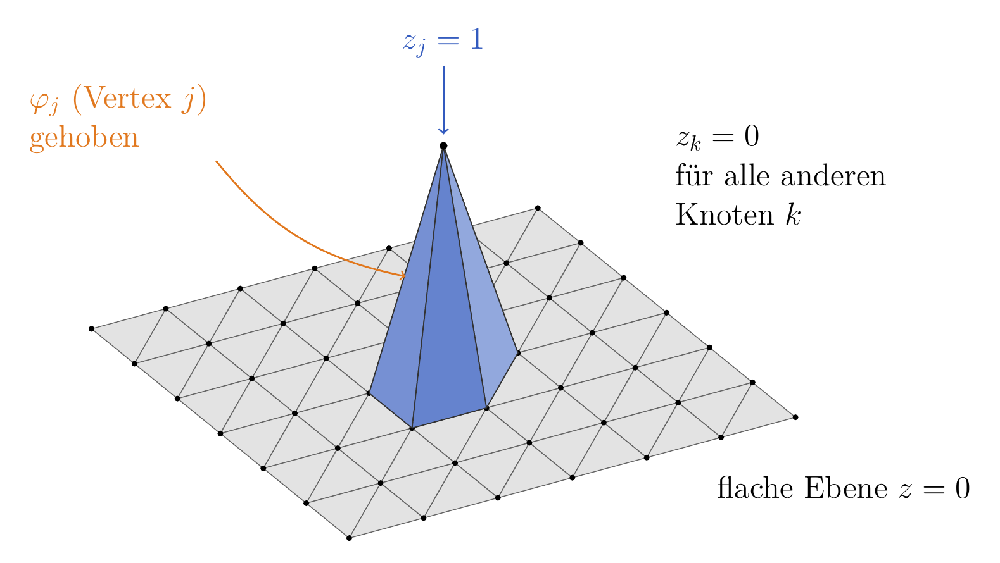
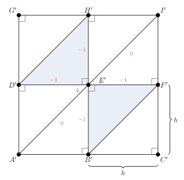
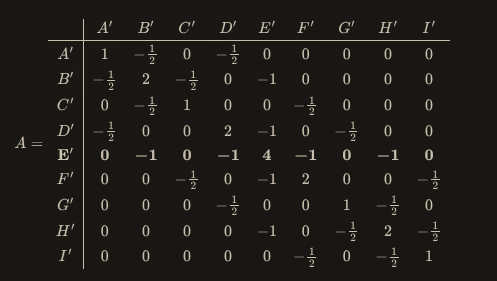

# Documentation fem2d

*AI-Disclaimer: this document has been created with the help of Claude Opus 5.5. Claude helped with the wording, with correcting mistakes and with the translation, but the content and structure has otherwise been created, edited and supervised by humans.*

This documentation explains how the program `fem2d` solves the Poisson equation $-\Delta u = f$ on a triangular mesh. First come the theoretical foundations up to $Az = b$, then a calculation by hand, and last the algorithm, with the matching code from `src/main.cc` placed alongside. At the end, the individual files of the program and a few examples to try out are listed.

Compass:
- Building and running the program: see `README.md`
- Path from the `.geo` to ParaView: see `docs/pipeline.md`

## 0. What the program does

`fem2d` reads a triangular mesh from Gmsh, sets up the linear system $Az = b$ from it using linear hat functions (P1 elements), solves it and writes the solution out as a `.vtk` for ParaView. In its current state, the following applies:
- $k = 1$, so we only solve $-\Delta u = f$
- $u = 0$ is prescribed on the whole boundary (homogeneous Dirichlet condition); other boundary values or Neumann boundaries are not built in yet
- $f$ is defined as a lambda at the top of `src/main.cc` and not read from a file, i.e. for a different $f$ one has to rebuild
- only ASCII files in Gmsh format 2.x or 4.x are read

## 1. Mathematical background and problem formulation

We want to solve the PDE $-\nabla\cdot(k\nabla u)=f$ or $-\Delta u=f$ for $k = 1$ with a given source function $f$ and $u = 0$ on the boundary; with this we examine a scalar field on a given mesh, taking local particularities into account. In general we cannot compute $u$ directly, but we can approximate it.

For this we use hat functions. Each node $i$ of the mesh has a function $\varphi_i$ with

$$\varphi_i\in C^0(\overline\Omega),\qquad \varphi_i\big|_T\in\mathbb{P}_1\ \ \forall\,T\in\mathcal{T}_h,\qquad \varphi_i(x_j)=\delta_{ij}=\begin{cases}1 & i=j\\ 0 & i\neq j\end{cases}$$

It is continuous on the whole domain $\overline\Omega$, on every triangle $T$ a linear polynomial $a + bx + cy$ and therefore a flat, tilted plane, and it lies at height 1 at its own node $i$ and at 0 at all other nodes of the mesh.



From the hat functions we put together the approximation

$$u_h=\sum_j z_j\,\varphi_j$$

where the nodal values $z_j=u_h(x_j)$ are what the program computes in the end.

We cannot insert $u_h$ directly into $-\Delta u=f$, because the second derivatives of a piecewise linear function are 0 or not defined. Therefore we use the weak form, in which only the first derivatives appear,

$$\int_\Omega\nabla u_h\cdot\nabla\varphi_i\,dx=\int_\Omega f\varphi_i\,dx$$

This gives one equation for every node $i$ and, taken together, the linear system

$$Az = b,\qquad A_{ij}=\int_\Omega \nabla\varphi_i\cdot\nabla\varphi_j\,dx,\qquad b_i=\int_\Omega f\varphi_i\,dx$$

## 2. Example calculation by hand

Before we get to the general case, we work through $Az = b$ once on a small mesh with 9 nodes $A'$ to $I'$, which consists of eight right triangles with legs of length $h$.



Since all triangles are congruent, it is enough to look at a reference triangle with the right angle at $(0, 0)$ and the other corners at $(h, 0)$ and $(0, h)$. The three hat functions on it are

$$\varphi_0 = 1 - \tfrac{1}{h}x - \tfrac{1}{h}y,\qquad \varphi_1=\tfrac1h x,\qquad \varphi_2=\tfrac1h y$$

with the gradients $\nabla\varphi_0=\left(-\tfrac1h,\ -\tfrac1h\right)$, $\nabla\varphi_1=\left(\tfrac1h,\ 0\right)$ and $\nabla\varphi_2=\left(0,\ \tfrac1h\right)$.

Because the gradients are constant on the triangle, every integral becomes value times area $|T|=\tfrac{h^2}{2}$, and for the local matrix it follows that

$$A^{\text{loc}}_{ab}=|T|\,\nabla\varphi_a\cdot\nabla\varphi_b,\qquad A^{\text{loc}}=\begin{pmatrix}1&-\tfrac12&-\tfrac12\\-\tfrac12&\tfrac12&0\\-\tfrac12&0&\tfrac12\end{pmatrix}$$

The right angle gets 1 on the diagonal, the acute corners ½, the entries along the legs −½ and the entry along the hypotenuse 0.

A global entry $A_{ij}$ is the sum of the matching local entries of all triangles that contain both nodes $i$ and $j$,

$$A_{ij}=\sum_{T\ni i,j}A^{\text{loc},T}_{ab}$$

where $a$ and $b$ are the local numbers (0, 1, 2) of the two nodes in the respective triangle. For the middle node $E'$, summing up the six triangles around it gives the diagonal entry 4 and −1 to the neighbours $B'$, $D'$, $F'$ and $H'$.



For constant $f$, $\iint_T\varphi_a\,dx\,dy$ is the volume of a pyramid with base $|T|$ and height 1, so that every corner locally gets $f\cdot\tfrac{|T|}{3} = f\cdot\tfrac{h^2}{6}$. Since $E'$ lies in six triangles, $b_{E'} = fh^2$.

With all boundary values 0, the row $E'$ of $Az = b$ leaves only

$$4z_{E'}=fh^2\quad\Rightarrow\quad z_{E'}=\tfrac{fh^2}{4}$$

-> This result is suitable as a test case for the program; on the unit square with $h = 0.5$ and $f = 1$, the middle node has to come out at $z_{E'} = 0.0625$, although the matching mesh file still has to be created.

## 3. Local matrix for an arbitrary triangle

In a mesh from Gmsh every triangle looks different, which is why the program has to compute the local matrix for a triangle with arbitrary corners $(x_0,y_0)$, $(x_1,y_1)$ and $(x_2,y_2)$.

The hat function $\varphi_0$ is 0 everywhere on the edge between corner 1 and corner 2, which is why its gradient is perpendicular to this edge, and its length is chosen so that $\varphi_0$ has the value 1 at corner 0. The same pattern applies to the other two corners, so that

$$\nabla\varphi_i=\frac{1}{2|T|}\begin{pmatrix}\beta_i\\ \gamma_i\end{pmatrix},\qquad \beta=(y_1-y_2,\ y_2-y_0,\ y_0-y_1),\qquad \gamma=(x_2-x_1,\ x_0-x_2,\ x_1-x_0)$$

with the area from the determinant

$$|T|=\tfrac12\big|(x_1-x_0)(y_2-y_0)-(x_2-x_0)(y_1-y_0)\big|$$

For the local matrix we compute, as in 2., gradient times gradient times area and get

$$A^{\text{loc}}_{ij}=|T|\,\nabla\varphi_i\cdot\nabla\varphi_j=\frac{\beta_i\beta_j+\gamma_i\gamma_j}{4|T|}$$

Whether the corners are numbered clockwise or counterclockwise does not matter, because the sign cancels in the product $\beta_i\beta_j$ or $\gamma_i\gamma_j$.

If, as a check, one inserts the reference triangle from 2., then $\beta=(-h,\ h,\ 0)$, $\gamma=(-h,\ 0,\ h)$ and $|T|=\tfrac{h^2}{2}$, from which e.g. $A^{\text{loc}}_{00}=1$, $A^{\text{loc}}_{01}=-\tfrac12$ and $A^{\text{loc}}_{12}=0$ follow, which matches the matrix from the hand calculation.

For the right-hand side, $f$ is in general not constant, which is why the program evaluates $f$ at the centroid of the triangle

$$b^{\text{loc}}_a\approx f(x_S, y_S)\cdot\tfrac{|T|}{3},\qquad (x_S,y_S)=\left(\tfrac{x_0+x_1+x_2}{3},\ \tfrac{y_0+y_1+y_2}{3}\right)$$

which for constant $f$ again gives the pyramid volume from 2. and is an approximation otherwise (centroid rule).

In the code:
```cpp
double area = 0.5 * std::abs((x1 - x0) * (y2 - y0) - (x2 - x0) * (y1 - y0));

double beta[3] = {y1-y2, y2-y0, y0-y1};
double gamma[3] = {x2-x1, x0-x2, x1-x0};

double c = f((x0 + x1 + x2) / 3.0, (y0 + y1 + y2) / 3.0)*area/3;
...
A_loc[i][j] = (beta[i] * beta[j] + gamma[i] * gamma[j]) / (4.0 * area);
```

## 4. Program flow

The flow in `src/main.cc` follows the algorithm given by Prof. Dr. Bastian, with the initialisation merged into the matrix generation (see 4.1).

### 4.0 Input
`fem2d` is called with the path to the `.msh` and optionally the path for the output, e.g.
```bash
./build/fem2d meshes/disk.msh results/disk.vtk
```
Without a second path, the result ends up in `results/squaresolution.vtk`. The mesh reader turns the file into a `fem::Mesh` with the node coordinates `points`, the triangles `triangles` as three node numbers each (counted from 0) and the list `on_boundary`, which states for every node whether it lies on the boundary:
```cpp
const fem::Mesh mesh = fem::read_gmsh_msh(argv[1]);
const auto& points = mesh.points;
const auto& triangles = mesh.triangles;
```

### 4.1 Initialisation
Instead of first going through all triangles as planned, collecting the non-zero fields of the global matrix and then freezing the structure, this loop was dropped in the code, because the hdnum builder creates an entry by itself on first access with `builder[a][b] += ...`. The structure is only frozen after the boundary treatment with `builder.build()`, which is why at the start only the builder and the two vectors for $b$ and $z$ are created:
```cpp
const std::size_t N = points.size();
hdnum::SparseMatrix<double>::builder builder(N, N);
hdnum::Vector<double> B(N, 0.0);
hdnum::Vector<double> z(N, 0.0);
```

### 4.2 Matrix generation
The program goes through all triangles once, computes the local 3x3 matrix and the local 3-vector for each one as in 3. and adds the values at the matching positions of the global matrix and of $b$, where `T[i]` translates the local number $i$ into the global node number:
```cpp
for (int i = 0; i < 3; i++) {
  auto a = T[i];
  B[a] += c;
  for (int j = 0; j < 3; j++) {
    auto b = T[j];
    A_loc[i][j] = (beta[i] * beta[j] + gamma[i] * gamma[j]) / (4.0 * area);
    builder[a][b] += A_loc[i][j];
  }
}
```

### 4.3 Boundary treatment
For every boundary node, its row is replaced by a unit row and $b_i = 0$ is set, so that the equation for this node is $z_i = 0$. In addition, the code sets the column of the node to 0 so that $A$ stays symmetric (this is only allowed because the boundary value is 0; for a boundary value $g \neq 0$, the value $A_{ji}\,g$ would first have to be subtracted from $b_j$ for every neighbour $j$):
```cpp
for (std::size_t i = 0; i < N; i++) {
  if (on_boundary[i]) {
    B[i] = 0.0;
    for (auto& [j, value] : builder[i]) {
      value = 0.0;
      builder[j][i] = 0.0;
    }
    builder[i][i] = 1.0;
  }
}
```

### 4.4 Solving and output
After freezing with `builder.build()`, $Az = b$ is solved with the LU decomposition for sparse matrices from hdnum and the solution is written out for ParaView:
```cpp
auto A = builder.build();
auto LU = hdnum::sparseLUDecomposition(A);
z = hdnum::sparseLUSolver(LU, B);
fem::write_vtk(output, mesh, z);
```

## 5. Files and functions

| File | Content |
|---|---|
| `include/fem/mesh.hh` | Struct `fem::Mesh` with `points` (coordinates $x$, $y$ of all nodes), `triangles` (three node numbers per triangle, counted from 0) and `on_boundary` (`true` for every node that lies on the boundary) |
| `include/fem/mesh_reader.hh` | `fem::read_gmsh_msh(path)` reads an ASCII file in Gmsh format 2.x or 4.x and returns a `fem::Mesh`; all nodes on a boundary edge (element type 1) count as boundary nodes, and for a malformed file a `std::runtime_error` is thrown |
| `include/fem/vtk_writer.hh` | `fem::write_vtk(path, mesh, u)` writes mesh and nodal values as legacy VTK, which ParaView can open (by default the field is called `u` in ParaView) |
| `src/main.cc` | Main program with choice of $f$, assembly, boundary treatment, solving and output (see 4.) |
| `meshes/` | `.geo` files and small `.msh` files for the examples |
| `tests/` | small tests, among others for the mesh reader |
| `external/hdnum` | hdnum as a Git submodule |

## 6. Examples

In `src/main.cc` there is a separate $f$ for every example; one uncomments the desired one and comments out the others, rebuilds and runs the program with the matching mesh. The exact solution is known for every example, so that the result can be compared with it in ParaView:

| Domain | Mesh | Exact solution $u$ | Source function $f$ |
|---|---|---|---|
| Unit square | `meshes/square.msh` | $\sin(\pi x)\sin(\pi y)$ | $2\pi^2\sin(\pi x)\sin(\pi y)$ |
| Unit disk | `meshes/disk.msh` | $1 - x^2 - y^2$ | $4$ |
| L-shaped domain | `meshes/l_shape.msh` | $p(x)\,p(y)$ with $p(t) = t(1-t)(t-0.5)$ | $-\big(p''(x)\,p(y)+p(x)\,p''(y)\big)$ |

A good exercise is to halve $h$ in the `.geo` and observe how fast the approximation approaches the exact solution, which connects to the error order from Part 3 of the slides [if available].
